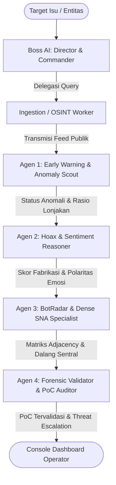

# 🛡️ NusaVision — Cognitive Domain Radar
### Platform Intelijen Siber Sosial & Analisis Opini Publik Berbasis Multi-Agent AI
**Kategori:** Siber Sosial (Social Cyber Defense)  
**Kompetisi:** Kartika Cyber Hackathon 2026  
**Status:** Production Ready • v1.0.0  

---

## 📌 Ringkasan Eksekutif

**NusaVision** adalah sistem intelijen siber sosial otonom (Cognitive Domain Defense Platform) yang dirancang untuk mendeteksi, menganalisis, dan memitigasi operasi disinformasi terorkestrasi, infiltrasi jaringan botnet/buzzer, serta manipulasi polarisasi opini publik di ruang siber Indonesia secara *real-time*.

Platform ini mengintegrasikan **Hierarchical Multi-Agent AI System** dengan *Local Reasoning Engine* (**DeepSeek-R1 8B via Ollama**) dan modul *Open Source Intelligence* (OSINT) nir-ketergantungan API berbayar. Antarmuka operator menyajikan *Single-Page Application* bertema *Cyber Command Terminal* (`#040406` & Crimson Red `#ff2a2a`) dengan visualisasi topologi graf *Social Network Analysis* (SNA) rimbun interaktif multi-hop dan dashboard dinamika sentimen multi-series.

```
+-----------------------------------------------------------------------------------+
|                              NUSAVISION ARCHITECTURE                              |
+-----------------------------------------------------------------------------------+
|  [OSINT Ingestion] ---> [Anomaly Scout] ---> [Hoax & Sentiment Reasoner]          |
|  (RSS + DDG Search)      (Volumetric Spike)   (DeepSeek-R1 8B Fact-Check)         |
|                                                      |                            |
|  [Operator UI] <--- [Forensic Validator] <--- [BotRadar & Dense SNA Specialist]   |
|  (D3.js + SSE)      (Threat Level Escalation) (Jaccard + Centrality Topologies)   |
+-----------------------------------------------------------------------------------+
```

---

## 🏛️ 5 Pilar Pertahanan Cognitive Domain

1. **Buzzer / Bot Detection & Behavioral Profiling**  
   Mendeteksi kluster akun otomatis melalui heuristik perilaku: frekuensi posting serentak (temporal anomaly), keseragaman leksikal tinggi, rasio follower/following abnormal, dan pola koordinasi amplifikasi tagar.
2. **Dual-Mode Hoax Classifier & RAG Fact-Checking**  
   - *Mode A (Fast Claim Screening):* Pengecekan cepat klaim viral terhadap database fakta terpercaya.  
   - *Mode B (Deep Structural Narrative Investigation):* Investigasi komprehensif struktur narasi menggunakan penalaran mendalam DeepSeek-R1 dengan dekomposisi fabrikasi narasi, pola transmisi, dan kredibilitas rujukan.
3. **Sentiment Dynamics & Longitudinal Mood Dashboard**  
   Pelacakan polaritas sentimen publik (Positif, Netral, Negatif) dalam rentang waktu modular (Harian, Mingguan, Bulanan, Tahunan) dilengkapi visualisasi multi-series Chart.js.
4. **Social Network Analysis (SNA) Berbasis Graf Rimbun Interaktif**  
   Visualisasi graf terarah *force-directed* (D3.js v7) yang memetakan hubungan multi-hop antar entitas/akun, menghitung derajat sentralitas (betweenness & degree centrality), serta mengunci simpul dalang utama (*coordinator hub*).
5. **Early Warning Radar Isu Viral Lintas Platform**  
   Deteksi lonjakan volume percakapan per detik untuk memilah apakah anomali bersifat organik (*Natural Variation*) atau serangan rekayasa opini (*Deliberate Orchestrated Surge*).

---

## 🤖 Hierarki Multi-Agent AI Office

Sistem mengadopsi pola orkestrasi **Autonomous ReAct State-Machine** dengan pembagian peran spesifik:



| Agen | Nama Modul | Peran & Tanggung Jawab Operasional |
| :--- | :--- | :--- |
| **Boss AI** | `Director / Commander` | Menerima instruksi target, merumuskan strategi investigasi siber sosial, mengorkestrasi alur kerja agen bawah, dan mengevaluasi kelayakan laporan akhir. |
| **Ingestion Worker** | `OSINT Fetcher` | Menarik percakapan aktual publik melalui transmisi Google News RSS dan DuckDuckGo News Search tanpa API key berbayar. |
| **Agen 1** | `Anomaly Scout` | Menganalisis lonjakan volume percakapan per satuan waktu untuk membedakan pergerakan opini organik vs. amplifikasi buatan (*orchestrated burst*). |
| **Agen 2** | `Hoax & Sentiment Reasoner` | Menjalankan inferensi penalaran DeepSeek-R1 8B dengan teknik RAG verifikasi silang untuk mengukur probabilitas fabrikasi narasi dan polaritas sentimen. |
| **Agen 3** | `Dense SNA Specialist` | Mengkalkulasi skor probabilitas botnet, membangun matriks relasi graf rimbun puluhan node, dan mengidentifikasi simpul koordinator utama (*central mastermind*). |
| **Agen 4** | `Forensic Validator` | Melakukan audit silang seluruh bukti digital dari Agen 1–3, menetapkan eskalasi ancaman (*LOW, MEDIUM, HIGH, CRITICAL*), dan menerbitkan Proof of Concept (PoC) tervalidasi. |

---

## 📐 Formulasi Matematis & Heuristik Deteksi

### 1. Skor Probabilitas Botnet ($P_{\text{bot}}$)
Perhitungan probabilitas botnet menggabungkan bobot multi-parameter:
$$P_{\text{bot}} = w_1 \cdot T_{\text{sync}} + w_2 \cdot S_{\text{lex}} + w_3 \cdot R_{\text{meta}} + w_4 \cdot A_{\text{freq}}$$

- $T_{\text{sync}}$: Keserentakan waktu transmisi ($\Delta t < 3 \text{ detik}$)
- $S_{\text{lex}}$: Kesamaan leksikal teks (Jaccard Index & TF-IDF Cosine Similarity)
- $R_{\text{meta}}$: Anomali profil (akun baru, rasio following/follower ekstrem, default avatar)
- $A_{\text{freq}}$: Volume amplifikasi per menit di atas ambang batas wajar ($> 15 \text{ posts/min}$)
- Bobot parameter: $w_1 = 0.30, w_2 = 0.35, w_3 = 0.20, w_4 = 0.15$

### 2. Koefisien Kesamaan Leksikal (Jaccard Similarity)
$$J(A, B) = \frac{|A \cap B|}{|A \cup B|}$$
Jika rata-rata $J(A, B) \ge 0.65$ pada $\ge 5$ akun berbeda dalam jendela waktu sempit, kluster diklasifikasikan sebagai *Copy-Paste Amplification Swarm*.

### 3. Identifikasi Dalang Sentral (*Betweenness Centrality*)
$$C_B(v) = \sum_{s \ne v \ne t} \frac{\sigma_{st}(v)}{\sigma_{st}}$$
Node dengan nilai sentralitas tertinggi yang memiliki derajat koneksi ke node bot dikunci sebagai *Central Coordinator Hub*.

---

## 💻 Tech Stack & Environment

- **Host & Environment:** Windows 11 + WSL 2 (Kali Linux)
- **Backend Framework:** FastAPI, Uvicorn (Port `8080`), Python 3.12+
- **Asynchronous Protocol:** Asyncio, Server-Sent Events (SSE) untuk streaming *real-time token audit*
- **Local Reasoning Engine:** Ollama menjalankan `deepseek-r1:8b` (REST endpoint `127.0.0.1:11434`) dengan sanitasi tag `<think>...</think>`
- **Live OSINT Fetching:** DuckDuckGo Search (`ddgs`), Google News RSS Feeds, BeautifulSoup4, Feedparser
- **Frontend Architecture:** Single-Page Application (SPA) mandiri (`backend/index.html` & `frontend/index.html`)
  - **Styling:** Custom Cyberpunk Minimalist Terminal (Background `#040406`, Accent Crimson `#ff2a2a`, Card `#0e0e14`, Border `#1c1c24`)
  - **Typography:** Standar satu jenis font monospace murni (`Courier New`) tanpa percampuran font sans-serif
  - **Iconography:** 100% Inline Custom SVG (Nol emoji di seluruh antarmuka pengguna)
  - **Visualizations:** D3.js v7 (Interactive Force-Directed Multi-Hop Graph), Chart.js (Multi-Series Trend Line), Canvas Particle Scan, Progressive Preloader (0–100%)

---

## 📡 Dokumentasi Spesifikasi API

### 1. `GET /`
Mengembalikan antarmuka produksi Single-Page Application NusaVision.

### 2. `GET /api/dashboard-overview`
Ringkasan metrik statistik operasional sistem.
```json
{
  "total_investigations": 142,
  "bots_flagged": 38,
  "hoaxes_neutralized": 27,
  "active_threat_level": "HIGH",
  "system_uptime": "99.98%"
}
```

### 3. `GET /api/live-trends`
Feed isu viral publik terkini yang diekstrak langsung dari sumber RSS dan DuckDuckGo.
```json
{
  "status": "success",
  "timestamp": "2026-11-07T16:20:00Z",
  "trends": [
    {
      "tag": "#RupiahDigital",
      "sentiment": "Positif",
      "anomaly": "Organik",
      "volume": "12.4k"
    }
  ]
}
```

### 4. `GET /api/sentiment-trends?timeframe={daily|weekly|monthly|yearly}`
Data deret waktu pergerakan sentimen publik multi-series untuk Chart.js.
```json
{
  "status": "success",
  "timeframe": "daily",
  "labels": ["00:00", "04:00", "08:00", "12:00", "16:00", "20:00"],
  "series": {
    "positive": [45, 52, 48, 60, 55, 62],
    "neutral": [30, 28, 32, 25, 27, 24],
    "negative": [25, 20, 20, 15, 18, 14]
  }
}
```

### 5. `GET /api/hoax-feed`
Koleksi berita/klaim viral terverifikasi beserta rincian kredibilitas RAG dan distribusi media penyebar.
```json
{
  "status": "success",
  "feed": [
    {
      "id": "hx-01",
      "title": "Bocoran Jadwal Pemadaman Listrik Massal Jawa-Bali",
      "hoax_score": 88,
      "breakdown": {
        "fabrication": 92,
        "spread_pattern": 85,
        "credibility": 14
      },
      "verified_sources": ["PLN Official Press Release", "Kominfo Antihooks"],
      "media_spread": {
        "social_media": 64,
        "fake_websites": 18,
        "chain_messages": 82,
        "dark_forums": 6
      }
    }
  ]
}
```

### 6. `POST /api/hoax-check`
Pengecekan langsung terhadap klaim spesifik dari pengguna.
- **Payload:** `{"claim": "Pemerintah bagikan kuota internet gratis 100GB via link Telegram"}`
- **Response:**
```json
{
  "status": "verified",
  "verdict": "HOAX",
  "hoax_probability": 96.4,
  "analysis": "Narasi terbukti fabrikasi phishing credential sniffing menggunakan domain spoofing.",
  "official_sources": ["kominfo.go.id", "turnbackhoax.id"]
}
```

### 7. `GET /api/stream-investigation?target={query}`
Endpoint Server-Sent Events (SSE) yang memancarkan audit trail multi-agent secara real-time langkah-demi-langkah:
- Event: `status` | `thought` | `agent_output` | `final_poc`

---

## 🚀 Panduan Instalasi & Menjalankan Sistem

### 1. Prasyarat Sistem
- Windows 11 dengan WSL 2 (Kali Linux / Ubuntu)
- Python 3.12 atau lebih baru
- Ollama terpasang dan berjalan di `http://127.0.0.1:11434`

### 2. Persiapan Model Penalaran Lokal
Pastikan model `deepseek-r1:8b` telah diunduh di Ollama:
```bash
ollama pull deepseek-r1:8b
ollama list
```

### 3. Setup Virtual Environment Python di WSL 2
```bash
# Masuk ke direktori proyek
cd /mnt/d/nusavision/backend

# Buat dan aktifkan virtual environment
python3 -m venv ~/venv_nusavision
source ~/venv_nusavision/bin/activate

# Install dependensi
pip install fastapi uvicorn beautifulsoup4 feedparser duckduckgo_search pyyaml httpx requests
```

### 4. Menjalankan Server NusaVision
Jalankan Uvicorn pada port `8080` (port `8000` dihindari untuk mencegah bentrok dengan aplikasi lokal lain):
```bash
uvicorn main:app --host 0.0.0.0 --port 8080 --reload
```

### 5. Akses Antarmuka Operator
Buka browser dan navigasikan ke:
```
http://127.0.0.1:8080
```

---

## 🔄 Konvensi Git & Alur Kerja Commit Selanjutnya

Setiap perubahan di masa depan **wajib** mengikuti aturan standardisasi berikut:
1. **Format Pesan Commit:** Mengikuti standar *Conventional Commits*:
   - `feat(...)`: Fitur baru (agen, endpoint, algoritma, komponen visual)
   - `fix(...)`: Perbaikan bug atau penyesuaian error handling
   - `docs(...)`: Pembaruan dokumentasi atau arsitektur sistem
   - `refactor(...)`: Restrukturisasi kode tanpa mengubah fungsionalitas
   - `perf(...)`: Peningkatan performa komputasi inferensi atau graf
2. **Pesan Rinci:** Sertakan *bullet points* detail perubahan pada setiap *commit message*.
3. **Commit Terstruktur:** Jangan melakukan *monolithic commit*. Kelompokkan perubahan berdasarkan modul fungsionalnya (misal: backend agent terpisah dari frontend visualizer).
4. **Branch Utama:** `main`.

---

## 👥 Tim Pengembang & Hak Cipta

- **Proyek:** NusaVision (Cognitive Domain Radar)
- **Kompetisi:** Kartika Cyber Hackathon 2026
- **Pengembang:** 4asec / Raffa Danendra (`raffadanendra2008@gmail.com`)
- **Lisensi:** MIT License © 2026 NusaVision Team. All rights reserved.
