# NUSAVISION // MASTER SUBMISSION DOSSIER
**Kartika Cyber Hackathon 2026 — Kategori Siber Sosial (Cognitive Domain)**
*Penyelenggara: Pusat Siber TNI Angkatan Darat (PUSSIBERAD) × CODEPOLITAN*

---

> [!IMPORTANT]
> **Sisa Waktu Menuju Batas Akhir Submission**: Kurang dari **28 Jam** (Batas Akhir: **15 November 2026, 23:59 WIB**).  
> Dokumen ini memuat seluruh rancangan siap-eksekusi untuk 5 komponen wajib formulir pengumpulan karya di portal perlombaan.

---

## 1. PETA 5 KOMPONEN SUBMISSION PORTAL

Berdasarkan formulir resmi submission, berikut adalah 5 item yang harus diisi beserta status kesiapannya:

| No | Komponen Formulir | Ketentuan Penyelenggara | Status & Solusi NusaVision |
|:---:|:---|:---|:---|
| **1** | **Link Karya / Project\*** | Link publik (download / live / demo / repo) | **SIAP**: Repository GitHub publik [`4asec/NusaVision`](https://github.com/4asec/NusaVision) |
| **2** | **Link Video Demo YouTube\*** | Durasi maks. 10 menit, publik/unlisted | **SIAP**: Panduan rekaman 5 menit (layar + slides + voiceover) & deskripsi YouTube. |
| **3** | **Link Slide Penjelasan Karya\*** | Format presentasi (Google Slides/Canva publik) | **SIAP**: Interactive HTML Slide Deck (`http://127.0.0.1:8080/slides` / repo link) & 12 slide deck Canva. |
| **4** | **Thumbnail Karya\*** | Wajib 1200×630 px, JPG/PNG/WebP, maks. 500KB | **SELESAI DIBUAT**: `D:\nusavision\submission_assets\thumbnail_nusavision_1200x630.png` (82 KB). |
| **5** | **Screenshot Karya\*** | Maksimal 5 gambar interface alur solusi | **SELESAI DIBUAT**: 5 Screenshot 1920×1080 di `D:\nusavision\submission_assets\screenshots\`. |

---

## 2. KOMPONEN 1: LINK KARYA / PROJECT

Masukkan link berikut pada kolom input formulir:

```text
https://github.com/4asec/NusaVision
```

> [!NOTE]
> Repository telah dilengkapi dengan:
> 1. `README.md` berstandar militer (latar belakang ancaman siber sosial, hierarki 5-agent, topologi SNA, diagram ASCII).
> 2. Panduan instalasi dan deployment lokal (FastAPI, DeepSeek-R1 via Ollama, D3.js).
> 3. Dokumentasi endpoint REST API dan arsitektur audit digital SSE.
>
> **Opsi Tambahan (Live Demo Public Web)**: Jika Dewan Juri ingin mencoba langsung di web tanpa instalasi lokal, kita dapat mengaktifkan Cloudflare Tunnel gratis atau Ngrok dalam 1 menit:
> ```bash
> cloudflared tunnel --url http://localhost:8080
> ```

---

## 3. KOMPONEN 2: NASKAH & STORYBOARD VIDEO DEMO YOUTUBE (DURASI 5–6 MENIT)

Video demo harus padat, percaya diri, dan langsung menjawab kriteria penilaian: **Relevansi TNI AD (25%)**, **Inovasi Teknis (25%)**, dan **Fungsionalitas Purwarupa (25%)**.

```
Durasi Rekomendasi : 05:30 Menit (Maksimal diizinkan: 10 Menit)
Resolusi Video     : 1080p (1920x1080) 60fps
Format Audio       : Suara Jelas / Voiceover Tegas & Profesional
```

### Storyboard Menit-per-Menit

#### BAGIAN 1: INTRO & LATAR BELAKANG PERTAHANAN KOGNITIF (00:00 – 01:00)
- **Visual Layar**:
  - Tampilkan halaman Hero Beranda NusaVision (`http://localhost:8080`).
  - Sorot Logo Monogram Elang NV yang besar, badge siaga merah berkedip `COGNITIVE DOMAIN DEFENSE RADAR`, dan carousel feed viral yang berotasi otomatis.
- **Narasi Voiceover**:
  > *"Halo Dewan Juri Kartika Cyber Hackathon 2026. Di era perang modern, medan pertempuran tidak lagi terbatas pada darat, laut, udara, dan infrastruktur siber fisik semata, melainkan telah merambah ke domain kelima: Cognitive Domain atau perang persepsi sosial.*  
  > *Operasi disinformasi, propaganda komputasional, dan jaringan buzzer botnet terkoordinasi dapat memicu polarisasi horizontal dan mengancam stabilitas nasional dalam hitungan jam.*  
  > *Untuk menjawab tantangan tersebut, kami mempersembahkan **NusaVision — Cognitive Domain Radar**, platform intelijen siber sosial mandiri berbasis hierarki Multi-Agent AI dan model penalaran lokal DeepSeek-R1 yang dirancang khusus untuk memperkuat postur pertahanan Pusat Siber TNI Angkatan Darat (PUSSIBERAD)."*

---

#### BAGIAN 2: DASHBOARD SENTIMEN & EARLY WARNING ANOMALI ISU (01:00 – 02:15)
- **Visual Layar**:
  - Scroll halus ke **Section 02: Dashboard Sentimen & Early Warning**.
  - Klik tab rentang waktu bergantian: `Harian` -> `Mingguan` -> `Bulanan`.
  - Sorot grafik multi-series (Positif, Negatif, Netral).
  - Tunjukkan panel kanan **Early Warning Isu Viral**: arahkan kursor ke indikator titik merah berkedip `TERORKESTRASI` vs titik hijau `NATURAL`.
  - Klik salah satu card hashtag trending di bawah.
- **Narasi Voiceover**:
  > *"Memasuki modul pertama: Dashboard Sentimen & Radar Early Warning. Di sini, operator intelijen dapat memantau denyut emosi publik secara multi-series sepanjang waktu.*  
  > *Keunggulan utama kami terletak pada **Agen 1: Early Warning & Anomaly Scout**. Agen ini mengukur kecepatan volume transmisi narasi per detik. Algoritma kami mampu membedakan secara otomatis: apakah lonjakan percakapan publik bersifat organik alami (ditandai warna hijau), atau merupakan serangan terorkestrasi serentak oleh jaringan terkoordinasi (ditandai badge merah).*  
  > *Dengan deteksi dini ini, komando satuan dapat mengantisipasi eskalasi sebelum suatu narasi provokatif meledak menjadi konflik di lapangan."*

---

#### BAGIAN 3: SOCIAL NETWORK ANALYSIS & AUTONOMOUS TASK FORCE (02:15 – 03:45)
- **Visual Layar**:
  - Pindah ke **Section 03: Social Network Analysis & ACTF**.
  - Ketik topik di input sasaran: `#PilkadaSerentak2024`, lalu klik tombol merah **Luncurkan Satgas ACTF**.
  - Perlihatkan kartu komando 5 Unit ACTF berganti status secara real-time via SSE: `STRATCOM` -> `SIGNAL SCOUT` -> `NEURAL REASONER` -> `NEXUS TOPOLOGY` -> `VERITAS AUDITOR`.
  - Perlihatkan graf D3.js bergerak dinamis (*force-directed*).
  - Ketik username di search bar multi-hop (misal: `@lead_hub_ops`). Perlihatkan seluruh simpul non-afiliasi meredup (*dimmed*), dan jaringan 1st serta 2nd-degree menyala merah pekat.
  - Klik simpul Dalang Utama berwarna merah bersinar untuk membuka panel profil intelijen di sisi kanan.
- **Narasi Voiceover**:
  > *"Inilah inti inovasi teknis NusaVision: Orkestrasi Autonomous Cognitive Task Force (ACTF) dan Social Network Analysis berbasis graf rimbun.*  
  > *Saat target operasi dimasukkan, STRATCOM Orchestrator membagi tugas investigasi: SIGNAL SCOUT memvalidasi lonjakan anomali, NEURAL REASONER membedah distorsi narasi kognitif, NEXUS TOPOLOGY merekonstruksi topologi jaringan dan menghitung probabilitas botnet, hingga VERITAS AUDITOR menyegel bukti digital.*  
  > *Graf force-directed D3.js kami secara presisi mengunci **Simpul Dalang Utama (Central Coordinator)**. Fitur pencarian multi-hop memungkinkan analis menelusuri rantai komando akun buzzer hingga 2 derajat relasi secara instan, lengkap dengan skor bot, bio, dan pola posting serentak."*

---

#### BAGIAN 4: DUAL-MODE HOAX CLASSIFIER & PENALARAN DEEPSEEK-R1 (03:45 – 04:45)
- **Visual Layar**:
  - Scroll ke **Section 04: Hoax Classifier & RAG Fact Lab**.
  - Klik salah satu kartu berita hoaks viral di kolom kiri.
  - Sorot kolom detail kanan: progress bar skor hoaks total (94%), fabrikasi narasi, pola penyebaran serentak, dan tautan rujukan resmi Kominfo/TurnBackHoax.
  - Masukkan teks klaim kustom pada form uji cepat, klik tombol **Verifikasi Fakta Sekarang**.
  - Perlihatkan hasil analisis penalaran DeepSeek-R1 yang muncul mandiri.
- **Narasi Voiceover**:
  > *"Modul keempat adalah Dual-Mode Hoax Classifier. Sistem ini bekerja dua arah: memantau disinformasi viral lintas platform secara berkala, dan menyediakan lab forensik interaktif untuk menguji klaim narasi baru.*  
  > *Didukung metode Retrieval-Augmented Generation (RAG) yang diverifikasi silang ke pangkalan data periksa fakta resmi, serta model penalaran **DeepSeek-R1 lokal**, sistem memberikan vonis kredibilitas, breakdown probabilitas fabrikasi narasi, serta daftar rujukan bukti secara transparan tanpa ketergantungan API pihak ketiga berbayar."*

---

#### BAGIAN 5: KESIMPULAN, NILAI STRATEGIS TNI AD & PENUTUP (04:45 – 05:30)
- **Visual Layar**:
  - Klik tombol **Ekspor PoC (Markdown / JSON)** di panel audit untuk menunjukkan file laporan forensik yang siap dipakai operasional.
  - Tampilkan slide penutup / ringkasan arsitektur di layar.
- **Narasi Voiceover**:
  > *"Seluruh hasil investigasi dapat diekspor menjadi berkas Proof of Concept (PoC) tervalidasi dengan level ancaman resmi untuk keperluan komando taktis.*  
  > *NusaVision dibangun dengan arsitektur mandiri, dapat berjalan secara offline/on-premise demi keamanan data intelijen negara, dan siap diintegrasikan pada Pusat Operasi Keamanan Siber PUSSIBERAD.*  
  > *Kami siap mempertahankan kedaulatan kognitif Republik Indonesia di ruang siber. Terima kasih, Satria Yudha Waskita!"*

---

### Teks Deskripsi YouTube Siap Pakai

```text
JUDUL VIDEO:
NusaVision — Cognitive Domain Defense Radar | Kartika Cyber Hackathon 2026 (Siber Sosial)

DESKRIPSI:
Demonstrasi prototipe "NusaVision" — Platform Intelijen Siber Sosial & Analisis Opini Publik untuk mendeteksi disinformasi, propaganda komputasional, jaringan botnet, dan polarisasi opini publik secara otonom.

Dikembangkan untuk:
Kompetisi: Kartika Cyber Hackathon 2026
Penyelenggara: Pusat Siber TNI Angkatan Darat (PUSSIBERAD) & CODEPOLITAN
Kategori: Siber Sosial (Cognitive Domain)
Repository: https://github.com/4asec/NusaVision

TIMESTAMPS:
00:00 - Pendahuluan & Urgensi Domain Kognitif TNI AD
01:00 - Modul Sentimen & Early Warning Anomali Isu Viral
02:15 - Orkesrtasi Satgas Multi-Agent & Live SSE Audit Stream
03:00 - Social Network Analysis (SNA) & Penguncian Dalang Utama
03:45 - Dual-Mode Hoax Classifier & Reasoning DeepSeek-R1
04:45 - Validasi Bukti Forensik PoC & Nilai Strategis Pertahanan

#KartikaCyberHackathon2026 #PUSSIBERAD #TNIAD #SiberSosial #NusaVision #CognitiveWarfare #AI
```

---

## 4. KOMPONEN 3: STRUKTUR 12 SLIDE PRESENTASI (CANVA / GOOGLE SLIDES)

Salin konten berikut ke template slide pilihan Anda (rekomendasi tema: *Dark Cyber Minimalist / Military Tactical Intelligence*, warna dominan hitam `#06070a`, merah `#E10600`, putih `#ffffff`).

```mermaid
flowchart LR
    S1[01. Judul & Brand] --> S2[02. Latar Belakang]
    S2 --> S3[03. Problem Statement]
    S3 --> S4[04. Solusi NusaVision]
    S4 --> S5[05. Arsitektur Multi-Agent]
    S5 --> S6[06. Fitur 1: Sentimen Radar]
    S6 --> S7[07. Fitur 2: Dense SNA]
    S7 --> S8[08. Fitur 3: Hoax Lab]
    S8 --> S9[09. DeepSeek Reasoning]
    S9 --> S10[10. Nilai Bagi TNI AD]
    S10 --> S11[11. Roadmap Satuan]
    S11 --> S12[12. Profil Tim & Penutup]
```



### Rincian Konten Slide per Slide

#### SLIDE 1: COVER PRESENTASI
- **Judul Utama**: NUSAVISION
- **Sub-judul**: Cognitive Domain Defense Radar
- **Keterangan**: Sistem Pertahanan Siber Sosial Mandiri Berbasis Hierarki Multi-Agent Otonom & Model Reasoning Komputasional
- **Badge**: Kartika Cyber Hackathon 2026 // Kategori Siber Sosial
- **Instansi Mitra**: Pusat Siber TNI Angkatan Darat (PUSSIBERAD) & CODEPOLITAN

#### SLIDE 2: LATAR BELAKANG & MEDAN TEMPUR KOGNITIF
- **Poin Utama**:
  - Spektrum ancaman siber telah bergeser dari sekadar serangan infrastruktur teknis (DDoS, malware) menuju *Cognitive Warfare* (perang psikologis dan manipulasi persepsi publik).
  - Indonesia menghadapi tingkat kerentanan tinggi terhadap operasi disinformasi terorkestrasi menjelang agenda strategis nasional.
  - Kebutuhan mendesak TNI AD: *Situational Awareness* siber sosial real-time untuk mendeteksi bibit konflik sebelum termanifestasi di dunia fisik.

#### SLIDE 3: PERMASALAHAN NYATA (PAIN POINTS)
- **3 Masalah Kritis**:
  1. **Deteksi Terlambat**: Analisis manual media sosial memakan waktu berjam-jam saat narasi hoaks telah menyebar luas ke jutaan warga.
  2. **Buzzer Berkamuflase**: Jaringan bot modern memakai akun sleeper dan rotasi proxy yang sulit dibedakan dari opini masyarakat murni.
  3. **Ketergantungan API Asing & Masalah Kerahasiaan Data**: Ketergantungan pada model AI cloud berbayar berisiko membocorkan data sensitif intelijen ke luar negeri.

#### SLIDE 4: SOLUSI KAMI — NUSAVISION
- **Definisi Solusi**: Platform terpadu yang memantau, membedah, dan mengisolasi serangan kognitif digital secara mandiri.
- **4 Pilar Utama**:
  1. *Early Warning Anomaly Scout* (Deteksi lonjakan terorkestrasi vs organik).
  2. *Social Network Analysis (SNA)* (Penguncian simpul dalang buzzer).
  3. *Dual-Mode Hoax Classifier* (Verifikasi klaim viral via RAG silang).
  4. *Multi-Agent Autonomous Pipeline* (Audit digital berantai tanpa intervensi manual).

#### SLIDE 5: ARSITEKTUR TEKNOLOGI & MULTI-AGENT PROTOCOL
- **Bagan Hierarki Alur Kerja**:
  - **Boss AI (Commander)**: Mengurai target operasi & delegasi tugas taktis.
  - **Agen 1 (Scout)**: Membaca kecepatan transmisi per detik via RSS & search.
  - **Agen 2 (Reasoner)**: Analisis polaritas sentimen & probabilitas fabrikasi narasi.
  - **Agen 3 (SNA Specialist)**: Membangun matriks adjacency graf D3.js & menghitung probabilitas botnet.
  - **Agen 4 (Auditor)**: Memverifikasi silang bukti forensik & menerbitkan berkas PoC resmi.
- **Komunikasi Data**: Streaming Server-Sent Events (SSE) asinkronus ke web client.

#### SLIDE 6: FITUR UNGGULAN 1 — SENTIMEN & RADAR EARLY WARNING
- **Kapabilitas**:
  - Grafik tren dinamis multi-series: Positif, Negatif, Netral.
  - Pengelompokan rentang waktu: Harian, Mingguan, Bulanan, Tahunan.
  - Klasifikasi lonjakan isu: Algoritma memilah lonjakan organik (hijau) vs deliberate surge terorkestrasi (merah).
  - Grid pemantauan arah polaritas tagar viral lintas platform.

#### SLIDE 7: FITUR UNGGULAN 2 — DENSE SNA & PENGUNCIAN DALANG UTAMA
- **Kapabilitas**:
  - Visualisasi graf interaktif D3.js Force-Directed (simulasi fisik dinamis).
  - Algoritma sentralitas derajat & kedekatan (*betweenness centrality*) untuk mengisolasi dalang utama (*lead coordinator*).
  - Mesin pencari Multi-Hop Traversal: Mengunci dan menyoroti relasi 1st & 2nd degree dari akun target secara instan.
  - Profil intelijen akun lengkap dengan skor bot, riwayat unggahan, dan peringatan ancaman otomatis.

#### SLIDE 8: FITUR UNGGULAN 3 — DUAL-MODE HOAX CLASSIFIER & RAG
- **Kapabilitas**:
  - Mode 1: Feed agregasi disinformasi viral lintas media sosial terkini.
  - Mode 2: Lab forensik interaktif untuk uji cepat teks/narasi kustom.
  - Integrasi Retrieval-Augmented Generation (RAG) ke pangkalan data klarifikasi resmi (Kominfo, TurnBackHoax, CekFakta).
  - Transparansi 4 indikator manipulasi: Skor Hoaks Total, Fabrikasi Narasi, Pola Penyebaran, dan Kredibilitas Sumber.

#### SLIDE 9: KEUNGGULAN INOVASI — PENALARAN DEEPSEEK-R1 OFFLINE
- **Mengapa Berbeda dari Solusi Konvensional**:
  - Menggunakan model penalaran lokal `DeepSeek-R1:8b` yang berjalan di infrastruktur server internal (on-premise via Ollama).
  - Tanpa ketergantungan API cloud pihak ketiga (Zero Cloud Leakage).
  - Biaya operasional nol token eksternal (100% Free Open Source Tech Stack).
  - Kemampuan *chain-of-thought reasoning* yang mampu mengurai maksud terselubung dan sentimen bernuansa sarkasme lokal Indonesia.

#### SLIDE 10: RELEVANSI STRATEGIS BAGI PUSSIBERAD TNI AD
- **Manfaat Operasional Nyata**:
  - **Kecepatan Respons**: Memangkas waktu identifikasi dalang propaganda dari hari menjadi hitungan menit.
  - **Dokumentasi Bukti**: Menghasilkan dokumen Proof of Concept (PoC) terenkripsi dan dossier forensik siap komando.
  - **Kemandirian Teknologi**: Mendukung kedaulatan teknologi siber nasional tanpa risiko backdoor vendor asing.

#### SLIDE 11: KELAYAKAN IMPLEMENTASI & ROADMAP MASA DEPAN
- **Tahap 1 (Saat ini - Purwarupa Operasional)**: Web dashboard mandiri, 5-agent hierarchy, graf D3, DeepSeek lokal.
- **Tahap 2 (Integrasi Satuan)**: Konektor API direct streaming ke kanal internal TNI AD, integrasi database intelijen terenkripsi.
- **Tahap 3 (Mobile Tactical Deployment)**: Aplikasi lapangan untuk personel intelijen teritorial di seluruh Kodam/Korem.

#### SLIDE 12: PROFIL TIM, PENUTUP & KESIMPULAN
- **Nama Tim & Peran**:
  - Ketua Tim: Lead AI & Systems Architect
  - Anggota: Fullstack & Data Engineer / Cybersecurity Specialist
- **Komitmen**: Berkontribusi nyata bagi pertahanan kognitif bangsa.
- **Semboyan**: *"Satria Yudha Waskita — Mengawal Kedaulatan Informasi NKRI."*

---

## 5. KOMPONEN 4: THUMBNAIL KARYA RESMI (1200×630 PX)

File thumbnail resmi telah di-generate secara otomatis sesuai standar formulir:
- **Lokasi File**: [`D:/nusavision/submission_assets/thumbnail_nusavision_1200x630.png`](file:///D:/nusavision/submission_assets/thumbnail_nusavision_1200x630.png)
- **Dimensi**: Tepat **1200 × 630 px**
- **Ukuran File**: **88.79 KB** (Sangat aman di bawah batas 500 KB)
- **Format**: PNG High-Definition
- **Elemen Grafis**:
  - Logo Monogram Elang NV resmi dengan paruh melengkung (`#E10600` & `#FFFFFF`).
  - Efek radar konsentris melingkar khas pertahanan militer.
  - Badge resmi `KARTIKA CYBER HACKATHON 2026 // PUSSIBERAD TNI AD`.
  - Judul besar `NUSAVISION: COGNITIVE DOMAIN DEFENSE RADAR`.
  - 4 pilar fitur utama dan identitas `DEEPSEEK-R1 OFFLINE READY`.

---

## 6. KOMPONEN 5: DAFTAR 5 SCREENSHOT ANTARMUKA RESMI

Seluruh file telah digenerate dengan resolusi tajam **1920×1080 Full HD** dan tersimpan di folder `D:\nusavision\submission_assets\screenshots\`:

| No | File Screenshot | Bagian Antarmuka | Pesan Kunci untuk Dewan Juri |
|:---:|:---|:---|:---|
| **1** | `01_hero_radar_tactical_command.png` | **Hero & Live Radar Overview** | Monogram elang NV bercahaya, badge siaga siber, overview sistem, dan live carousel isu viral otomatis. |
| **2** | `02_sentiment_early_warning_matrix.png` | **Sentiment Dashboard & Early Warning** | Grafik tren emosi multi-series (Positif/Negatif/Netral) dan radar pemilah lonjakan *Terorkestrasi* vs *Organik*. |
| **3** | `03_dense_sna_force_directed_graph.png` | **Social Network Analysis (D3.js Graph)** | Graf rimbun interaktif, simpul sentral Dalang Utama bersinar merah, dan fitur multi-hop traversal. |
| **4** | `04_actf_autonomous_cognitive_task_force.png` | **Autonomous Cognitive Task Force (ACTF)** | Hierarki unit intelijen (STRATCOM, SIGNAL SCOUT, NEURAL REASONER, NEXUS TOPOLOGY, VERITAS AUDITOR) & status verifikasi PoC. |
| **5** | `05_hoax_classifier_rag_forensic.png` | **Hoax Classifier & DeepSeek R1 Lab** | Panel audit disinformasi, 4 indikator manipulasi narasi, dan hasil penelusuran fakta silang RAG. |

---

## 7. CHECKLIST AKHIR SUBMISSION (SEBELUM KLIK 'SIMPAN')

```markdown
- [ ] Link Karya/Project sudah diisi (Link GitHub: https://github.com/4asec/NusaVision)
- [ ] Link Slide Presentasi sudah diisi (Pastikan permission: 'Anyone with the link can view')
- [ ] Video Demo sudah diunggah ke YouTube (Status: 'Public' atau 'Unlisted', durasi < 10 menit)
- [ ] File thumbnail_nusavision_1200x630.png sudah di-upload di form
- [ ] 5 Screenshot antarmuka sudah di-upload ke form
- [ ] Klik tombol hijau 'Simpan' dan pastikan notifikasi sukses muncul!
```
